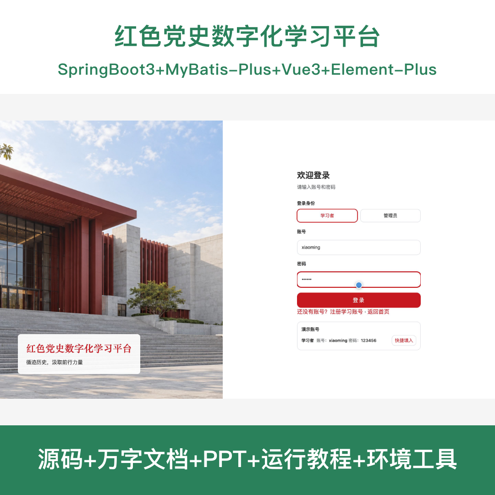
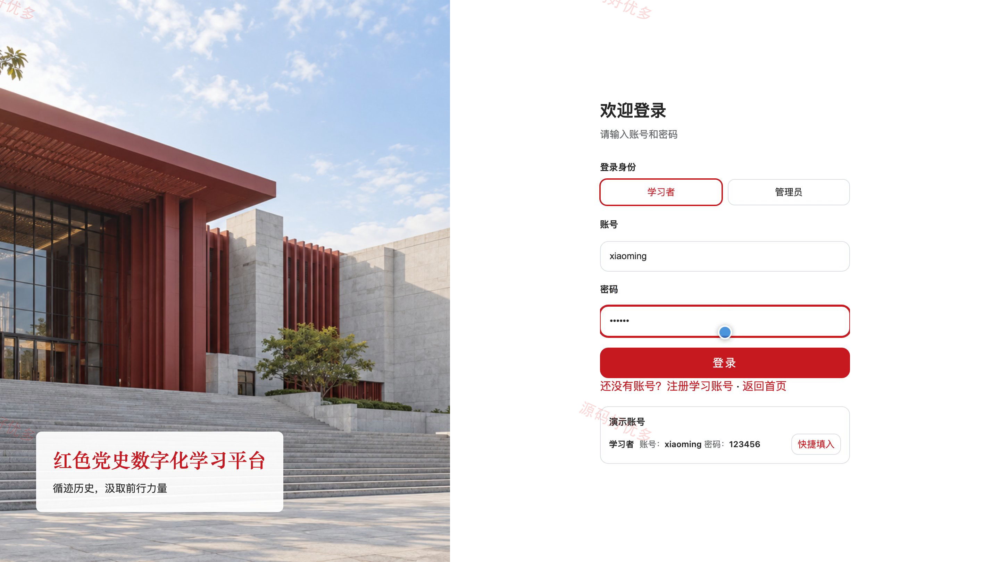
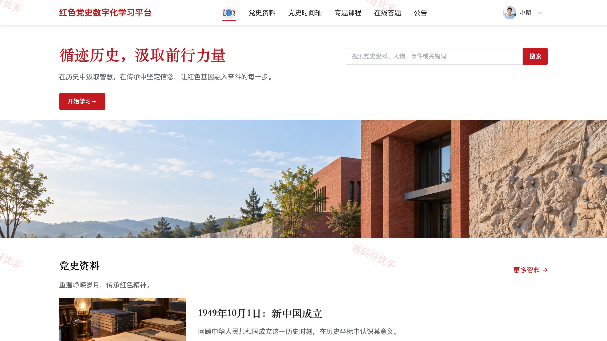
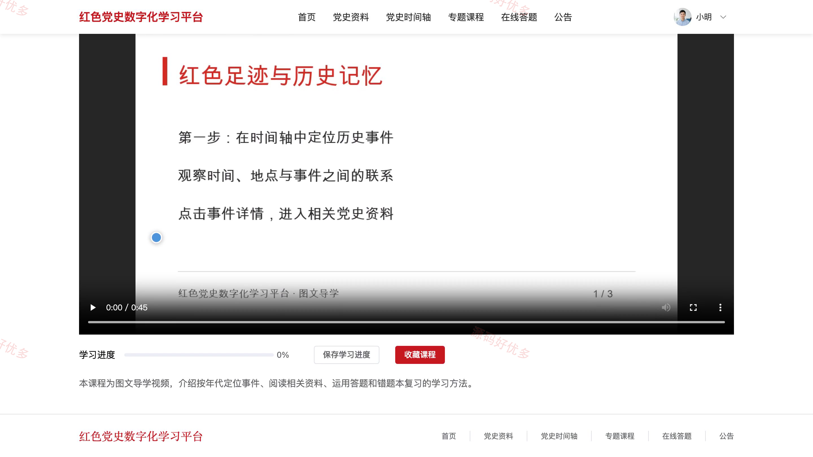
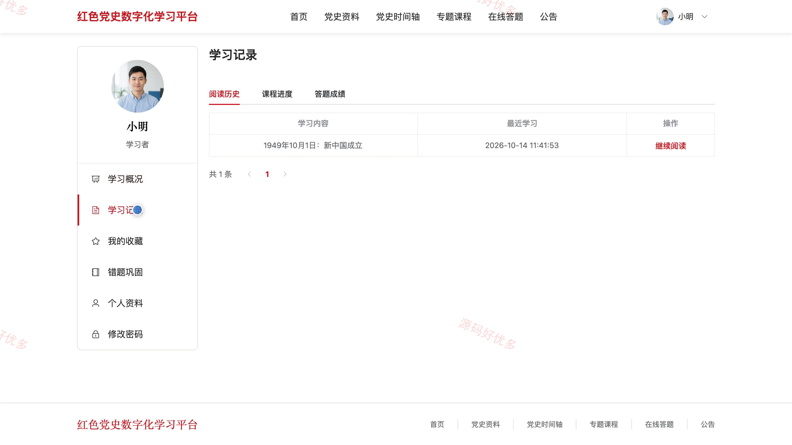
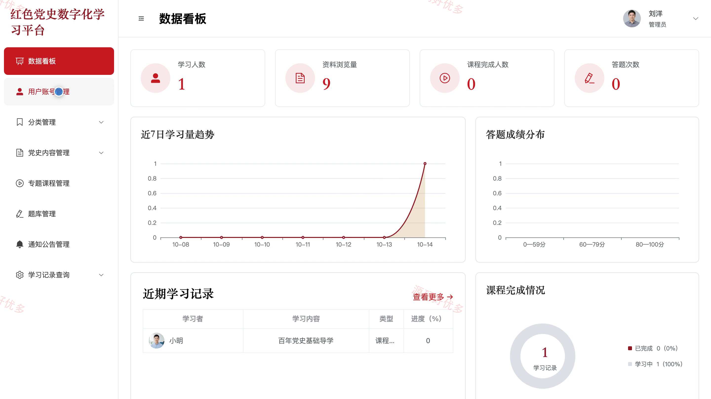
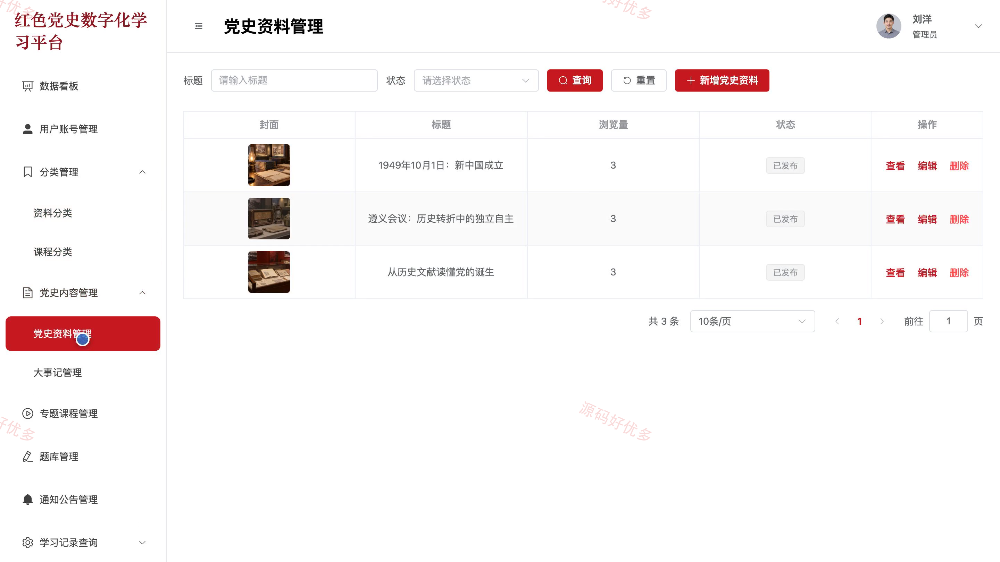
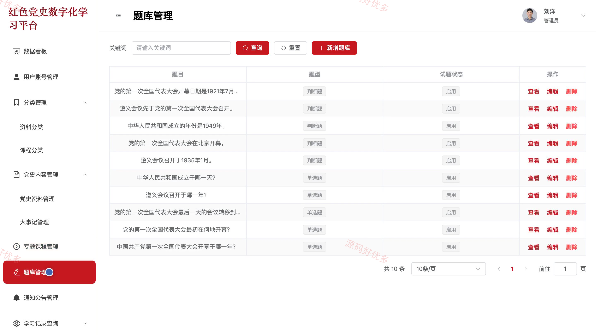
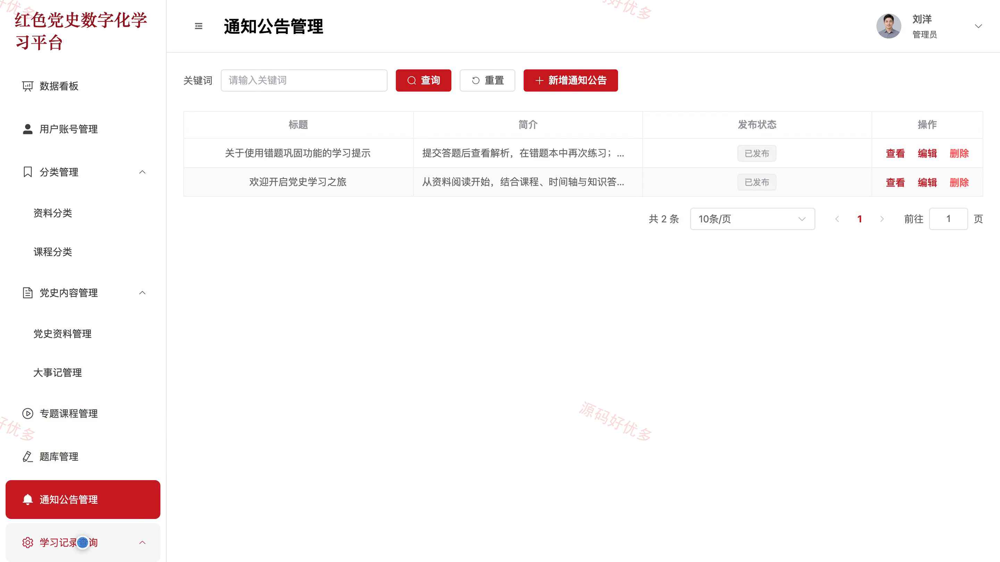

# bs163A
bs163A红色党史数字化学习平台系统源码 Java SpringBoot3 Vue3
## 源码问题查看主页咨询

### 一、关键词
党史学习、红色教育、党史知识答题、专题课程学习、党建学习平台

### 二、作品包含
源码+数据库+全套环境和工具资源+本地部署教程

### 三、项目技术
前端技术： Html、Css、Js、Vue3.4、Element-Plus
后端技术：Java、SpringBoot3.2.0、MyBatis-Plus

### 四、运行环境要求
开发工具：IDEA/eclipse + VSCODE

数据库：MySQL5.7+（共15张表）

数据库管理工具：Navicat10以上版本

环境配置软件： JDK17 + Maven3.6

前端Nodejs：20

浏览器：谷歌浏览器

### 五、项目介绍
项目编号：bs163A

红色党史数字化学习平台面向学习者和管理员，提供党史图文资料、历史事件时间轴、专题视频课程与在线知识答题。学习者可保存课程进度、回顾错题、查看学习记录并收藏内容；管理员通过数据看板维护用户、分类、资料、大事记、课程、题库和通知公告，查询各类学习记录。

角色：学习者、管理员

学习者功能：账号注册登录与个人资料维护、党史资料检索阅读与时间轴浏览、专题视频学习与进度保存、在线答题与自动评分解析、错题回顾重练与移出、学习记录与历次答题成绩查询、资料及课程收藏与取消、学习通知与公告查看。

管理员功能：登录与个人资料维护、学习数据看板、学习者账号与启停管理、资料及课程分类管理、党史资料与大事记管理、专题课程及视频发布管理、题库与通知公告管理、各类学习记录查询。

### 六、运行截图

